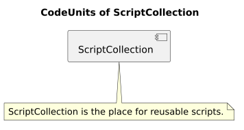

# ScriptCollection-reference

## Code-units-overview

## Lines-of-code

## Features

This section lists the features one would typically expect from a product like ScriptCollection (a collection of reusable scripts and build-/CI-automation).
The `state`-column reflects whether the feature is available (`available`) or only planned (`unavailable`), based on the documentation.

| id     | state     | description                                                                                                    |
| ------ | --------- | -------------------------------------------------------------------------------------------------------------- |
| feat-1 | available | Reusable collection of scripts and command-line tools for development- and operations-automation.              |
| feat-2 | available | Building codeunits of a common-project-structure repository via `scbuildcodeunits` (also containerized).       |
| feat-3 | available | Running a command for each entry of a folder via `scforeach`.                                                  |
| feat-4 | available | Printing file-content in a controlled way via `scprintfilecontent`.                                            |
| feat-5 | available | Remote-build support: running a build on a remote task-runner and writing the result back into the repository. |
| feat-6 | available | Downloading and providing external build-tools (for example JRE, TruffleHog, MediaMTX, FFmpeg, GRYLibrary).    |
| feat-7 | available | Generating a bill-of-materials (BOM) for codeunits during the build.                                           |
| feat-8 | available | Managing docker-based local test-services for builds and tests.                                                |
| feat-9 | available | Generating certificate-authorities and certificates via the ScriptCollection-core.                             |

## Findings

This table collects all findings of code-reviews, security-checks, bug-searches, performance-analyses and similar checks of this repository, as defined by the specification `openspec/specs/common-projects-structure-architecture/spec.md`.

| Id     | Priority  | State | Description                                                                                                                                                                                                                                                                                                                                 | Impact                                                                                                                                                                                                                                                                                                                                                                                                                                                                                                                        | Notes                                                                                                                                                                                                                                                                                                                                                                                                                                                                                                                                                                                                                                                                                                                                                          |
| ------ | --------- | ----- | ------------------------------------------------------------------------------------------------------------------------------------------------------------------------------------------------------------------------------------------------------------------------------------------------------------------------------------------- | ----------------------------------------------------------------------------------------------------------------------------------------------------------------------------------------------------------------------------------------------------------------------------------------------------------------------------------------------------------------------------------------------------------------------------------------------------------------------------------------------------------------------------- | -------------------------------------------------------------------------------------------------------------------------------------------------------------------------------------------------------------------------------------------------------------------------------------------------------------------------------------------------------------------------------------------------------------------------------------------------------------------------------------------------------------------------------------------------------------------------------------------------------------------------------------------------------------------------------------------------------------------------------------------------------------- |
| SEC-4  | very high | open  | `ProgramRunnerSudo.run_program_argsasarray` runs `sh -c "echo <password> \| sudo -k -S <program> <arguments>"`: the password is part of the command-line and the arguments are interpreted by the shell (only arguments with spaces are quoted).                                                                                            | The sudo-password can be read by every local user via the process-list (`ps`, `/proc/<pid>/cmdline`). Arguments or a password which contain shell-metacharacters (`;`, `$(...)`, backticks, `\|`) execute further commands with root-privileges.                                                                                                                                                                                                                                                                              | Found in the security-focused bug-search. Location: `ProgramRunnerSudo.py`. Not trivial: the password should be passed via stdin to `sudo -S` and the arguments as array without a shell, which requires stdin-support of the program-runner.                                                                                                                                                                                                                                                                                                                                                                                                                                                                                                                  |
| SEC-5  | very high | open  | `scforeach` (`Executables.ForEach`) inserts the path of every iterated entry unescaped into a command which is executed with `shell=True`.                                                                                                                                                                                                  | A file-name like `a$(touch pwned)` or `x";id;"` in the iterated folder (for example a cloned or extracted untrusted folder) executes arbitrary commands. Quoting `{path}` in the command does not prevent `$(...)` or backticks.                                                                                                                                                                                                                                                                                              | Found in the security-focused bug-search. Not trivial because it is an API-decision: either quote the path (`shlex.quote` on POSIX, `subprocess.list2cmdline` on Windows) or switch to an argument-array-based template.                                                                                                                                                                                                                                                                                                                                                                                                                                                                                                                                       |
| SEC-6  | very high | open  | `TFCPS_RemoteBuild` extracts the result-archive which it receives from the runner with `tarfile.extractall(..., filter="fully_trusted")`.                                                                                                                                                                                                   | A compromised runner or a man-in-the-middle on an `http`-runner-url can write arbitrary files on the client (absolute paths, `..`-entries, symlinks pointing outside of the result-folder), for example into `.git/hooks`, which results in code-execution on the developer-machine or the CI-client.                                                                                                                                                                                                                         | Found in the security-focused bug-search. Location: `TFCPS/TFCPS_RemoteBuild.py` (`__write_result_into_the_repository`). Not changed directly because `filter="data"` rejects absolute symlinks and links which point outside of the result-folder, which can be part of a legitimate build-result; it has to be decided which entries a result may contain. The server-side extraction in `SCTaskRunnerServer.py` uses the same filter, but there the client is already authenticated and allowed to run any program.                                                                                                                                                                                                                                         |
| SEC-7  | very high | open  | Executables which are downloaded by `TFCPS_Tools_General` are not verified against a checksum, and some of them are not pinned to a version at all (TruffleHog, MediaMTX, FFmpeg and GRYLibrary always use the latest release).                                                                                                             | A compromised upstream-release or upstream-account delivers manipulated binaries which are executed by the build (supply-chain-attack); the unpinned downloads additionally make the build not reproducible.                                                                                                                                                                                                                                                                                                                  | Found in the security-focused bug-search. Location: `ensure_file_from_github_assets_is_available` and the download-functions of the tools in `TFCPS/TFCPS_Tools_General.py`. TLS is verified. Not trivial: the expected hashes and versions have to be pinned, and where they are stored is a design-decision.                                                                                                                                                                                                                                                                                                                                                                                                                                                 |
| SEC-10 | very high | open  | The connection between `TFCPS_RemoteBuild` and `SCTaskRunnerServer` is not protected sufficiently: the client accepts `http`-runner-urls, the server listens on `0.0.0.0` with plain `http` when no certificate is given, and the server accepts empty credentials.                                                                         | Basic-credentials and the whole repository (including git-ignored secrets, by design) can be sent in clear text; a runner which was created with an empty username and password accepts every client which sends empty credentials and runs arbitrary programs for it.                                                                                                                                                                                                                                                        | Found in the security-focused bug-search. The credential-comparison was changed to the constant-time `hmac.compare_digest` directly. Rejecting empty credentials and requiring https (or allowing http only for localhost) are behavior-decisions.                                                                                                                                                                                                                                                                                                                                                                                                                                                                                                             |
| BUG-2  | high      | open  | `GeneralUtilities.replace_underscores_in_text` never terminates for self-referencing replacements.                                                                                                                                                                                                                                          | If a value contains its own placeholder (for example `{"a": "__a__"}`) or two values reference each other, the replacement-loop runs forever and the calling process hangs.                                                                                                                                                                                                                                                                                                                                                   | Former id: KI-05. State-check: the `while changed`-loop without cycle-detection is unchanged.                                                                                                                                                                                                                                                                                                                                                                                                                                                                                                                                                                                                                                                                  |
| BUG-5  | high      | open  | `ScriptCollectionCore.__reset_compose_bind_mounted_volumes_daemon_side` also treats bind-mount-sources which start with `/` or `~` as resettable and empties them with `rm -rf`.                                                                                                                                                            | In a build-container a compose-entry like `/srv/data:/data` or `~/.ssh:/root/.ssh` gets the content of that host-folder deleted (data-loss).                                                                                                                                                                                                                                                                                                                                                                                  | Found in the security-focused bug-search. Not trivial: it is a policy-decision which sources may be reset (for example only sources which start with `./`).                                                                                                                                                                                                                                                                                                                                                                                                                                                                                                                                                                                                    |
| SEC-1  | high      | open  | `GeneralUtilities.is_ignored_by_glob_pattern` does not reliably reject paths outside the source-directory, because the check is a plain `startswith`.                                                                                                                                                                                       | A sibling-folder with a shared prefix (for example `/folder/src2/a.txt` for the source-directory `/folder/src`) passes the check; its relative path starts with `..` and can still be matched by patterns like `*`, so files outside the source-directory can be treated as inside.                                                                                                                                                                                                                                           | Former id: KI-04. Category: bug/security. Fix: compare against the source-directory plus a trailing path-separator, as `ScriptCollectionCore.path_is_allowed_within_base_folder` already does. State-check: still `path.startswith(source_directory)`.                                                                                                                                                                                                                                                                                                                                                                                                                                                                                                         |
| SEC-2  | high      | open  | `scprintfilecontent` checks a different file than it reads when `-b` is not the current working-directory: a relative `-p` is resolved against `-b` for the permission-check, but the file is then read relative to the current working-directory.                                                                                          | With a base-folder other than `.` a file outside the base-folder or inside an excluded folder can be read, which bypasses the restriction (relevant for example for restricted AI-command-execution).                                                                                                                                                                                                                                                                                                                         | Former id: KI-08. Category: security. With `-b .` (the default) both paths are the same. Fix: read the same resolved path which was checked. State-check: `Executables.PrintFileContent` still passes the unresolved `file` to `get_file_content`.                                                                                                                                                                                                                                                                                                                                                                                                                                                                                                             |
| SEC-8  | high      | open  | The archives of the downloaded tools (JRE, TruffleHog, MediaMTX) are extracted with `tarfile.extractall` without a filter.                                                                                                                                                                                                                  | On Python 3.11 to 3.13 no filter means `fully_trusted`, so a manipulated archive (see SEC-7) can write files outside of the cache-folder.                                                                                                                                                                                                                                                                                                                                                                                     | Found in the security-focused bug-search. Location: `TFCPS/TFCPS_Tools_General.py`. Fix: `filter="data"`; this requires Python 3.11.4 or later, while `pyproject.toml` allows `>=3.11`, so the minimum-version has to be decided.                                                                                                                                                                                                                                                                                                                                                                                                                                                                                                                              |
| SEC-9  | high      | open  | The TLS-handshake of `SCTaskRunnerServer` is done while accepting a connection, which happens in the single thread of `serve_forever`, and the request-handler has no timeout.                                                                                                                                                              | One client which opens a TCP-connection and sends nothing blocks the accepting thread forever, before any authentication, so the runner accepts no further connections until it is restarted (denial-of-service). Without TLS every idle connection still occupies one thread forever.                                                                                                                                                                                                                                        | Found in the security-focused bug-search. Location: `TFCPS/SCTaskRunnerServer.py` (`run`). The obvious fix `wrap_socket(..., do_handshake_on_connect=False)` was tried and reverted: on machines where pip's truststore is injected into `ssl` (as on the development-machine of this analysis) `wrap_socket` then fails, so the fix needs an explicit handshake with a timeout in the handler-thread.                                                                                                                                                                                                                                                                                                                                                         |
| SEC-11 | high      | open  | The environment-variables for the test of a docker-image are passed as `-e <name>=<value>` on the docker-command-line.                                                                                                                                                                                                                      | The values are written to the build-log and into the message of the exception which is raised when the image-test fails, so a secret which is passed as test-environment-variable appears in the CI-log.                                                                                                                                                                                                                                                                                                                      | Found in the security-focused bug-search. Location: `TFCPS/Docker/TFCPS_CodeUnitSpecific_Docker.py`. Fix: pass only `-e <name>` and give the values via `env_vars`, as `TFCPS_CodeUnit_BuildCodeUnits.py` already does; this also allows values with whitespace (see the existing TODO there).                                                                                                                                                                                                                                                                                                                                                                                                                                                                 |
| SEC-12 | high      | open  | Several secrets are passed as command-line-arguments: `docker login -p <password>`, the `pass:<password>`-arguments of openssl, `dotnet nuget push --api-key`, `dotnet nuget add/update source --password` and the `--password`-arguments of CLI-commands like `scaddimagetocustomregistry`.                                                | The secrets can be read by every local user via the process-list and the CLI-arguments end up in the shell-history. `docker_login` additionally splits a password which contains a space into several arguments.                                                                                                                                                                                                                                                                                                              | Found in the security-focused bug-search. The leaks into the build-log and into exception-messages were fixed directly (masking for openssl, nuget push, 7z and the NuGet-source-password; twine-credentials are passed via environment-variables). Not trivial: passing the secrets via stdin (`--password-stdin`), environment-variables or files requires API-changes.                                                                                                                                                                                                                                                                                                                                                                                      |
| SEC-13 | high      | open  | `ScriptCollectionCore.restore_filemetadata` joins the paths from the metadata-file with the target-folder without checking that the result stays inside the folder.                                                                                                                                                                         | A manipulated metadata-file with an entry like `../../etc/shadow;f;attacker:attacker;777` changes owner and permissions of files outside of the folder, and `d`-entries create folders outside of it.                                                                                                                                                                                                                                                                                                                         | Found in the security-focused bug-search. Not trivial: the containment-check (realpath plus commonpath) changes the behavior for existing metadata-files, which has to be decided. The inverted symlink-flag of `set_owner` and the wrong offsets of `get_file_permission`, which made this worse, were fixed directly.                                                                                                                                                                                                                                                                                                                                                                                                                                        |
| SEC-14 | high      | open  | `ScriptCollectionCore.generate_certificate_authority` calls openssl with `-nodes` and `-passout pass:<password>`.                                                                                                                                                                                                                           | `-nodes` writes the private key of the certificate-authority unencrypted, and the given or generated password is silently ignored.                                                                                                                                                                                                                                                                                                                                                                                            | Found in the security-focused bug-search. Not trivial: whether the key has to be encrypted changes the behavior of the API and of its callers.                                                                                                                                                                                                                                                                                                                                                                                                                                                                                                                                                                                                                 |
| SEC-18 | high      | open  | `ScriptCollectionCore.create_deb_package` writes a `postinst`-script in which the public-API-parameter `toolname` is interpolated unescaped into `ln -s` and `chmod`-commands.                                                                                                                                                              | A `toolname` which contains shell-metacharacters or a newline (for example `x$(...)` or `x; <command>`) executes arbitrary commands as root when the generated `.deb`-package is installed with dpkg on the target-system.                                                                                                                                                                                                                                                                                                    | Found in the security-focused bug-search. Location: `ScriptCollectionCore.create_deb_package` (the `postinst`-script, around the `ln -s {exe_file} {link_file}`-line). Fix: validate `toolname` against a strict allow-list or do not embed it unescaped into the script. Reachable at package-installation-time on every machine which installs the produced package.                                                                                                                                                                                                                                                                                                                                                                                         |
| BUG-1  | mid       | open  | `GeneralUtilities.get_version_parts` accepts versions with arbitrary separators, because the dots in its regex `^(\d+).(\d+).(\d+)$` are not escaped.                                                                                                                                                                                       | Invalid version-strings like `1x2x3` are accepted as `1.2.3` instead of being rejected.                                                                                                                                                                                                                                                                                                                                                                                                                                       | Former id: KI-03. Fix: escape the dots (`\.`). State-check: regex in `GeneralUtilities.py` is unchanged.                                                                                                                                                                                                                                                                                                                                                                                                                                                                                                                                                                                                                                                       |
| BUG-6  | mid       | open  | `ScriptCollectionCore.add_image_to_custom_docker_image_registry` loads the registry-credentials but never uses them.                                                                                                                                                                                                                        | The copy of the image only works if docker is already logged in to the involved registries; the parameters `registry_username` and `registry_password` have no effect.                                                                                                                                                                                                                                                                                                                                                        | Found in the security-focused bug-search. Not trivial: it has to be decided to which registry the credentials belong and whether a login should be done.                                                                                                                                                                                                                                                                                                                                                                                                                                                                                                                                                                                                       |
| OTH-1  | mid       | open  | A containerized build (`scbuildcodeunits -c`/`scbuildcodeunitsc`) can not build a codeunit whose own scripts start a container themselves. The scripts of a codeunit are executed inside the build-container, and a container started from there would have to be a sibling of the build-container instead of a container inside it.        | Affected repositories can not use the containerized build and have to be built with the non-containerized `scbuildcodeunits`, so they lose the standardized build-environment.                                                                                                                                                                                                                                                                                                                                                | Former id: KI-01. Category: build-environment (limitation). Previously documented as partially fixed. Found in the repository AthenaTournamentManager (ATM), whose visual-regression-tests (`Other/QualityCheck/VisualRegressionContainer.py`) and whose linux-build start an SCBuilder-container. State-check: ScriptCollection now handles the sibling-case for the containers it starts itself (`TFCPS_VisualRegressionTests`, the betterleaks-scan, `PlantUMLRenderer` and the Flutter-build use `--volumes-from` with `ScriptCollectionCore.get_own_container_id`), so visual-regression-tests which use `TFCPS_VisualRegressionTests` work; a codeunit-script which starts its own container with bind-mounts is still not resolved by ScriptCollection. |
| OTH-3  | mid       | open  | ScriptCollection supports only exactly one version of the common-project-structure-definition (`CommonProjectStructureVersion` in `TFCPS_Tools_General.py`, currently `3.0.4`). Namespace, xsd-addresses and the supported codeunit-specification-version are all derived from this single value.                                           | Files which use another version (other namespace or other `codeunitspecificationversion`) can not be processed: xpath-queries find nothing and the codeunit-file-validation fails, for example for not yet migrated repositories or the codeunit-file of a downloaded GRYLibrary-release.                                                                                                                                                                                                                                     | Category: compatibility (limitation). Suggested improvement: other versions (for example the entries of `SupportedCommonProjectStructureVersions`) should be usable as fallback when a file does not use `CommonProjectStructureVersion`. Not implemented yet.                                                                                                                                                                                                                                                                                                                                                                                                                                                                                                 |
| SEC-3  | mid       | open  | The bill-of-materials of a node-codeunit is not written when one of its packages has an unsatisfied optional peer-dependency. `cyclonedx-npm` runs `npm ls --json --long --all`, npm reports an optional peer-dependency which is present in another version as `invalid` and exits non-zero, and `cyclonedx-npm` aborts on that exit-code. | The codeunit gets no BOM-artifact at all while the build still reports success, so the dependency- and vulnerability-overview of that codeunit is missing without anybody noticing.                                                                                                                                                                                                                                                                                                                                           | Former id: KI-02. Category: build/BOM; classified as security-relevant because the vulnerability-overview is affected. Found in the repository AthenaTournamentManager (ATM), codeunit `AthenaWebsite`: `jsdom` (through vitest) brings `@exodus/bytes` with the optional peer `@noble/hashes` in `^1.8.0 \|\| ^2.0.0`, while `pkijs` (through `@angular-devkit/build-angular`) pins it to `1.4.0`. Fix belongs where the tool is called: `cyclonedx-npm` has `--ignore-npm-errors` for this case. The `npm install --force` of the node-codeunit-automation hides such a conflict. State-check: `TFCPS_CodeUnitSpecific_NodeJS.py` and `TFCPS_CodeUnitSpecific_TypeScript.py` still call `cyclonedx-npm` without `--ignore-npm-errors`.                       |
| SEC-15 | mid       | open  | The ports of the local test-services are published as `<port>:<port>`, which docker binds to all network-interfaces.                                                                                                                                                                                                                        | Test-databases with known test-credentials are reachable from the network while the tests run on a developer-machine.                                                                                                                                                                                                                                                                                                                                                                                                         | Found in the security-focused bug-search. Location: `ScriptCollectionCore.__generate_localhost_ports_override_file`. Not changed directly because binding to `127.0.0.1` can break builds which run in a container and reach the test-services through the docker-host; this has to be checked first.                                                                                                                                                                                                                                                                                                                                                                                                                                                          |
| SEC-17 | mid       | open  | `GeneralUtilities.arguments_to_array` splits an argument-string on spaces without honoring quotes (acknowledged by its own `TODO`), so every `run_program`/`run_program_async`-call which builds its argument-string by interpolating a value that can contain a space passes additional arguments to the invoked program.                  | A value which contains a space (for example a service- or container-name taken from a built repository's compose-file in `kill_docker_container`/`start_local_test_service`, or a `--domain`/`--email` in `CertificateUpdater`) is split into several arguments, so extra flags or operands reach the invoked program (docker, certbot, ...). Because the programs are started without a shell this is argument-injection, not shell-injection, but it still changes which arguments a sometimes-privileged program receives. | Found in the security-focused bug-search. Location: `GeneralUtilities.arguments_to_array` (the `split(" ")` with the existing `TODO`). Distinct from SEC-4/SEC-5/SEC-16 (those go through a shell). Not trivial: the argument-string-API has to support quoted whitespace, or the affected callers have to pass argument-arrays.                                                                                                                                                                                                                                                                                                                                                                                                                               |
| SEC-19 | mid       | open  | The build-pipeline parses repository-supplied XML-files (`codeunit.xml`, product-information, `.csproj`/`.nuspec`, `pom.xml`, coverage-reports) with the raw `lxml.etree`-parser, whose default resolves entities, while `GeneralUtilities` deliberately uses `defusedxml` for the same purpose.                                            | A crafted XML-file in a built repository can use an external entity (`<!ENTITY x SYSTEM "file:///...">`) to read local files of the build-machine (XXE) and large entity-definitions to exhaust memory/CPU (entity-expansion-DoS); relevant when a repository of untrusted origin (for example a fork or pull-request) is built. External-network-fetching is disabled by lxml's default (`no_network`).                                                                                                                      | Found in the security-focused bug-search. Location: all `etree.parse`/`etree.fromstring`-calls in `TFCPS/` (for example `TFCPS_CodeUnitSpecific_Base.py`, `TFCPS_Tools_General.py` and the codeunit-specific DotNet/NodeJS/Maven/Rust/TypeScript-classes). The stdlib-`xml.etree.ElementTree`-usages (`ScriptCollectionCore.py` and others) are affected by the entity-expansion-DoS but not by the external-entity file-disclosure. Fix: parse with a hardened parser (`resolve_entities=False`, no DTD) or `defusedxml`, consistent with `GeneralUtilities`.                                                                                                                                                                                                 |
| SEC-21 | mid       | open  | The SCBuilder-image is not pinned: `.ScriptCollection/OCIImages/ImageDefinition.csv` defines it with the tag `latest`, and `TFCPS_CodeUnit_BuildCodeUnits.__update_agent_sandbox_image` derives the value `image` of `.ScriptCollection/AgentSandboxConfiguration.ini` from it.                                                             | Containerized builds and the `scrais`-sandbox use whatever the registry currently delivers as `latest`, so builds are not reproducible and a compromised or broken image takes effect without any change in the repository.                                                                                                                                                                                                                                                                                                   | Found while preparing the release 4.4.65: the first build with `__update_agent_sandbox_image` replaced the manually pinned `aniondev/scbuilder:v1.2.18` in the ini-file by `aniondev/scbuilder:latest`. Fix: pin a concrete tag in `ImageDefinition.csv`, the ini-file then follows automatically. Not changed directly because it changes the image of all containerized builds of this repository, which has to be decided.                                                                                                                                                                                                                                                                                                                                  |
| BUG-3  | low       | open  | `GeneralUtilities.timedelta_to_simple_string` is wrong for durations of 24 hours or more, because it formats a datetime with `%H`.                                                                                                                                                                                                          | The days are dropped, so for example 25 hours are shown as `01:00:00`.                                                                                                                                                                                                                                                                                                                                                                                                                                                        | Former id: KI-06. State-check: implementation still uses `strftime('%H:%M:%S')`.                                                                                                                                                                                                                                                                                                                                                                                                                                                                                                                                                                                                                                                                               |
| BUG-4  | low       | open  | The error-messages of `translate_safe` name a wrong path: they say the translation-service has to be configured in `~/.ScriptCollection/TranslationServiceProperties.txt`, while the file is read from `~/.ScriptCollection/GlobalCache/TranslationServiceProperties.txt`.                                                                  | Users who follow the error-message create the file at the wrong place and the translation stays unconfigured.                                                                                                                                                                                                                                                                                                                                                                                                                 | Former id: KI-07. Category: bug (error-message). Affects the NodeJS- and Flutter-codeunit-specific classes. State-check: wrong path still in `TFCPS_CodeUnitSpecific_NodeJS.py` and `TFCPS_CodeUnitSpecific_Flutter.py`.                                                                                                                                                                                                                                                                                                                                                                                                                                                                                                                                       |
| OTH-2  | low       | open  | The testcase `get_latest_version` in `test_GeneralUtilities.py` never runs because its name has no `test_`-prefix, and its expectation is wrong (it expects `3.1.0` as latest version of `["2.3.4","3.1.0","16.5"]`, although `16.5` is not a valid version for `get_latest_version`).                                                      | Dead and misleading test-code; no effect on the product itself.                                                                                                                                                                                                                                                                                                                                                                                                                                                               | Former id: KI-09. Category: test-quality. The intended behavior is covered by the `test_get_latest_version_*`-testcases, so the testcase can be removed. State-check: the method is still present.                                                                                                                                                                                                                                                                                                                                                                                                                                                                                                                                                             |
| SEC-16 | low       | open  | `ScriptCollectionCore.get_latest_apk_package_version_in_alpine` inserts the package-name unescaped into `sh -c "apk update && apk policy <package>"`.                                                                                                                                                                                       | A crafted package-name executes further commands, but only inside the temporary container of the given image.                                                                                                                                                                                                                                                                                                                                                                                                                 | Found in the security-focused bug-search. Low severity. The same pattern exists in `get_latest_apt_package_version_in_debian`.                                                                                                                                                                                                                                                                                                                                                                                                                                                                                                                                                                                                                                 |
| SEC-20 | low       | open  | `ProcessesRunner.run` identifies the processes it supervises only by their PID and, when one of them has ended, kills the remaining PIDs after a bare `pid_exists`-check without verifying process-identity.                                                                                                                                | On a system which reuses PIDs (regularly the case on Linux) the PID of an ended supervised process can already belong to an unrelated process when the kill-loop runs, so `ProcessesRunner` terminates an arbitrary foreign process (local integrity/availability). The surrounding `while enabled`-loop additionally spins without a sleep (one core at 100% for the whole runtime).                                                                                                                                         | Found in the security-focused bug-search. Location: `ProcessesRunner.run`. Not trivial: the processes have to be tracked by a handle which stays bound to the started process (for example the `Popen`-object) instead of by a reusable PID, and the loop should wait on the processes instead of polling.                                                                                                                                                                                                                                                                                                                                                                                                                                                     |
| BUG-7  | low       | open  | `TFCPS_Tools_General.try_update_basic_repositoryreference_from_examples_repository` downloads `Other/Reference/RepositoryStructure.mdd`, but the file in the repository CommonProjectStructureExamples is called `RepositoryStructure.md`.                                                                                                  | The address does not exist, so the file `Other/Reference/RepositoryStructure.md` of a repository can not be updated with this function.                                                                                                                                                                                                                                                                                                                                                                                       | Found while comparing the skills of the common project structure with the source-code. Fix: use the file-extension `.md` in the address.                                                                                                                                                                                                                                                                                                                                                                                                                                                                                                                                                                                                                       |
